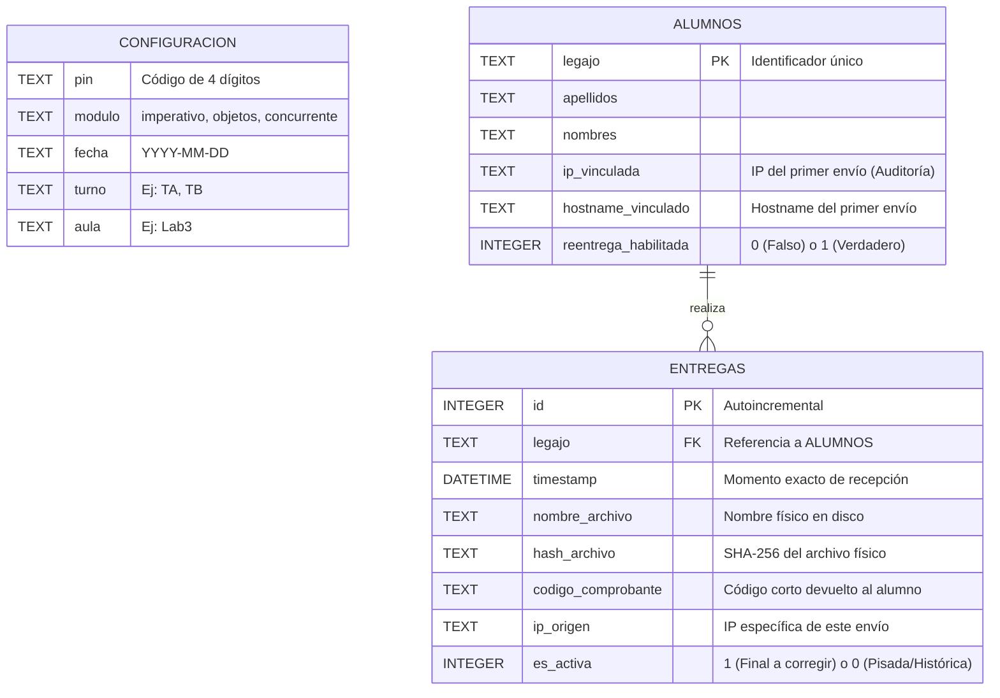

# Modelo de Datos - SEEP (Sistema de Entrega de Exámenes Parciales)

Este documento detalla la estructura relacional implementada para gestionar las entregas durante un examen. SEEP utiliza un modelo de **Base de Datos Efímera (Aislada por Sesión)**. No existe una base de datos global; en su lugar, se genera un archivo `seep_registro.db` (SQLite) dentro de la carpeta específica de cada evaluación (ej. `entregas_imperativo_20261011_TA_Aula1`).

La base de datos actúa estrictamente como un **índice relacional**. Los archivos de los exámenes (ej. `.pas`, `.zip`) se almacenan físicamente en el sistema de archivos del sistema operativo, garantizando que el docente pueda acceder a ellos directamente sin necesidad de exportarlos desde el sistema.

## Diagrama Entidad-Relación Conceptual

A continuación se presenta el modelo lógico mediante un diagrama de entidad-relación. Si tu repositorio soporta Mermaid (como GitHub o GitLab), este gráfico se renderizará automáticamente:

---

## Diccionario de Datos

### 1. Tabla `configuracion`

Actúa como la "memoria" del estado de la sesión. Contiene siempre una única fila. Garantiza que si el servidor sufre un cierre inesperado, pueda recuperar el contexto y el PIN al volver a inicializarse en la misma carpeta.

| Campo    | Tipo | Restricción | Descripción / Propósito                                              |
| :------- | :--- | :---------- | :------------------------------------------------------------------- |
| `pin`    | TEXT | `NOT NULL`  | Código numérico generado al inicio. Se recupera en caso de reinicio. |
| `modulo` | TEXT | `NOT NULL`  | Módulo evaluado (imperativo, objetos, concurrente).                  |
| `fecha`  | TEXT | `NOT NULL`  | Fecha de creación de la sesión (formato `YYYY-MM-DD`).               |
| `turno`  | TEXT | `NOT NULL`  | Turno de la cursada (ej. `TA`, `TB`).                                |
| `aula`   | TEXT | `NOT NULL`  | Espacio físico donde se rinde (ej. `Lab3`).                          |

### 2. Tabla `alumnos`

Registra de manera unívoca a cada estudiante que interactúa con el sistema. Es el pilar para evitar la suplantación de identidad y gestionar los permisos de reentrega.

| Campo                  | Tipo    | Restricción   | Descripción / Propósito                                                                                                                        |
| :--------------------- | :------ | :------------ | :--------------------------------------------------------------------------------------------------------------------------------------------- |
| `legajo`               | TEXT    | `PRIMARY KEY` | Clave primaria. Impide que se registren dos alumnos con el mismo legajo.                                                                       |
| `apellidos`            | TEXT    | `NOT NULL`    | Apellidos registrados en el primer envío.                                                                                                      |
| `nombres`              | TEXT    | `NOT NULL`    | Nombres registrados en el primer envío.                                                                                                        |
| `ip_vinculada`         | TEXT    | `NOT NULL`    | IP desde la cual se realizó el primer envío. Sirve como bandera de auditoría si entregas posteriores con el mismo legajo provienen de otra IP. |
| `hostname_vinculado`   | TEXT    | `NOT NULL`    | Nombre del equipo del primer envío.                                                                                                            |
| `reentrega_habilitada` | INTEGER | `DEFAULT 0`   | Booleano lógico (0 = Falso, 1 = Verdadero). Controlado por el docente desde el panel para autorizar envíos adicionales.                        |

### 3. Tabla `entregas`

Mantiene un historial inmutable de todos los archivos recibidos. Ningún registro se elimina, lo que permite resolver conflictos, verificar comprobantes y mantener un registro de auditoría completo.

| Campo                | Tipo     | Restricción   | Descripción / Propósito                                                                                                              |
| :------------------- | :------- | :------------ | :----------------------------------------------------------------------------------------------------------------------------------- |
| `id`                 | INTEGER  | `PRIMARY KEY` | Autoincremental.                                                                                                                     |
| `legajo`             | TEXT     | `FOREIGN KEY` | Referencia al legajo en la tabla `alumnos`.                                                                                          |
| `timestamp`          | DATETIME | `NOT NULL`    | Marca temporal exacta de la recepción (incluye milisegundos).                                                                        |
| `nombre_archivo`     | TEXT     | `NOT NULL`    | Nombre sanitizado final con el que se guardó el archivo en el sistema operativo.                                                     |
| `hash_archivo`       | TEXT     | `NOT NULL`    | Huella SHA-256 calculada tras guardar el archivo para garantizar integridad.                                                         |
| `codigo_comprobante` | TEXT     | `NOT NULL`    | Fragmento corto derivado del hash (ej. 6 caracteres) devuelto al alumno.                                                             |
| `ip_origen`          | TEXT     | `NOT NULL`    | IP desde la que ingresó esta petición HTTP específica.                                                                               |
| `es_activa`          | INTEGER  | `DEFAULT 1`   | Booleano lógico. Solo vale 1 para la entrega que el docente debe corregir. Si hay una reentrega, los registros anteriores pasan a 0. |

## 4. Limitaciones y Trabajo Futuro

### Ambigüedad en la Identificación (Legajo vs. DNI)

Actualmente, el sistema utiliza el valor ingresado manualmente por el alumno como clave primaria en la tabla `alumnos` (campo `legajo`). Dado que la metodología del examen permite ingresar indistintamente Legajo o DNI, existe el riesgo lógico de que un alumno intente evadir el bloqueo de reentregas enviando primero con su Legajo y luego con su DNI (o viceversa).

Al operar de forma _offline_, el servidor procesará esto como dos alumnos distintos, generando dos registros independientes. Si bien el docente lo detectará visualmente en el panel (dos filas activas con los mismos apellidos y nombres), representa una inconsistencia lógica.

**Evolución propuesta:**
En futuras iteraciones, se recomienda que al momento de configurar la sesión, el docente pueda cargar un archivo de padrón (ej. lista de inscriptos). Esto permitiría:

1. **Validación estricta:** Rechazar entregas de legajos que no pertenezcan al aula/turno.
2. **Unificación de identidad:** Ligar unívocamente el DNI con el Legajo en la base de datos, neutralizando la evasión de bloqueos por alternancia de identificadores.
3. **Control de ausentes:** Permitir que el Panel Docente contraste las entregas recibidas contra el padrón total, mostrando rápidamente quiénes faltan entregar.
