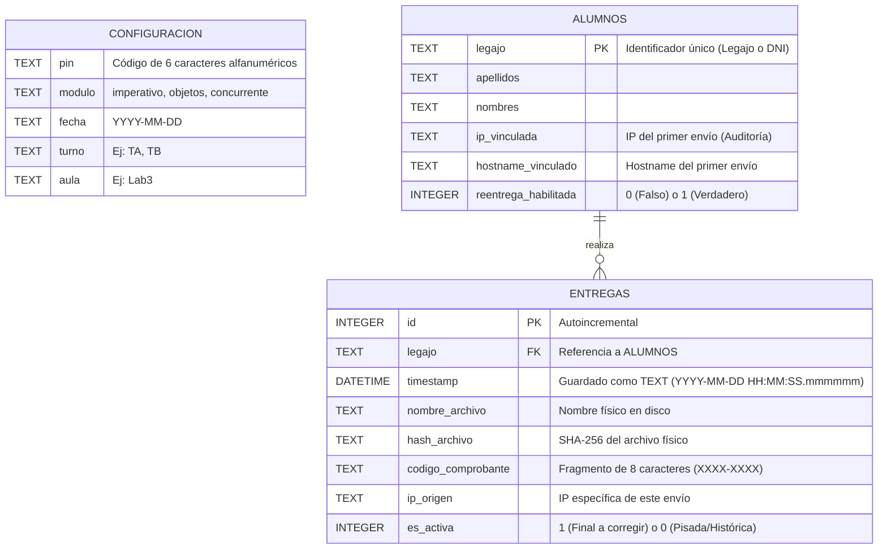

# Modelo de Datos - SEEP (Sistema de Entrega de Exámenes Parciales)

Este documento detalla la estructura relacional implementada para gestionar las entregas durante un examen. SEEP utiliza un modelo de **Base de Datos Efímera (Aislada por Sesión)**. No existe una base de datos global; en su lugar, se genera un archivo `seep_registro.db` (SQLite) dentro de la carpeta específica de cada evaluación (ej. `entregas_imperativo_20261011_TA_Aula1`).

La base de datos actúa estrictamente como un **índice relacional y motor de auditoría**. Los archivos de los exámenes (ej. `.pas`, `.zip`) se almacenan físicamente en el sistema de archivos del sistema operativo, garantizando que el docente pueda acceder a ellos directamente sin necesidad de exportarlos desde el sistema.

Agrego a la documentacion como el modulo de persistencia del servidor aprovecha la base de datos para introducir nuevas funcionalidades relacionadas a las seguridad y deteccion de anomalias.

## Diagrama Entidad-Relación Conceptual

A continuación se presenta el modelo lógico mediante un diagrama de entidad-relación.

## 1. Diccionario de Datos

### Tabla `configuracion`

Actúa como la "memoria" del estado de la sesión. Contiene siempre una única fila. Garantiza que si el servidor sufre un cierre inesperado, pueda recuperar el contexto y el PIN al volver a inicializarse en la misma carpeta.

| Campo    | Tipo | Restricción | Descripción / Propósito                              |
| :------- | :--- | :---------- | :--------------------------------------------------- |
| `pin`    | TEXT | `NOT NULL`  | Código seguro de 6 caracteres generado al inicio.    |
| `modulo` | TEXT | `NOT NULL`  | Módulo evaluado (imperativo, objetos, concurrente).  |
| `fecha`  | TEXT | `NOT NULL`  | Fecha de creación de la sesión (formato `YYYYMMDD`). |
| `turno`  | TEXT | `NOT NULL`  | Turno de la cursada (ej. `TA`, `TB`).                |
| `aula`   | TEXT | `NOT NULL`  | Espacio físico donde se rinde (ej. `Lab3`).          |

### Tabla `alumnos`

Registra de manera unívoca a cada estudiante que interactúa con el sistema. Es el pilar para evitar la suplantación de identidad y gestionar los permisos de reentrega.

| Campo                  | Tipo    | Restricción   | Descripción / Propósito                                                                                    |
| :--------------------- | :------ | :------------ | :--------------------------------------------------------------------------------------------------------- |
| `legajo`               | TEXT    | `PRIMARY KEY` | Clave primaria. Impide que se registren dos alumnos con el mismo identificador.                            |
| `apellidos`            | TEXT    | `NOT NULL`    | Apellidos registrados en el primer envío.                                                                  |
| `nombres`              | TEXT    | `NOT NULL`    | Nombres registrados en el primer envío.                                                                    |
| `ip_vinculada`         | TEXT    | `NOT NULL`    | IP desde la cual se realizó el primer envío. Sirve como bandera de auditoría de red.                       |
| `hostname_vinculado`   | TEXT    | `NOT NULL`    | Nombre de red del equipo de origen (Hostname).                                                             |
| `reentrega_habilitada` | INTEGER | `DEFAULT 0`   | Booleano lógico (0 = Falso, 1 = Verdadero). Controlado por el docente para autorizar envíos excepcionales. |

### Tabla `entregas`

Mantiene un historial inmutable de todos los archivos recibidos (incluyendo los anulados). Ningún registro se elimina (_Soft Deletion_), lo que permite resolver conflictos y mantener auditoría.

| Campo                | Tipo     | Restricción   | Descripción / Propósito                                                                                       |
| :------------------- | :------- | :------------ | :------------------------------------------------------------------------------------------------------------ |
| `id`                 | INTEGER  | `PRIMARY KEY` | Autoincremental.                                                                                              |
| `legajo`             | TEXT     | `FOREIGN KEY` | Referencia al legajo en la tabla `alumnos`.                                                                   |
| `timestamp`          | DATETIME | `NOT NULL`    | Marca temporal exacta de la recepción generada unívocamente por el servidor.                                  |
| `nombre_archivo`     | TEXT     | `NOT NULL`    | Nombre sanitizado con el que se guardó el archivo en el OS.                                                   |
| `hash_archivo`       | TEXT     | `NOT NULL`    | Huella SHA-256 calculada bloque a bloque para garantizar la integridad criptográfica.                         |
| `codigo_comprobante` | TEXT     | `NOT NULL`    | Primeros 8 caracteres del hash formateados (ej. `A1B2-C3D4`) devueltos como recibo al alumno.                 |
| `ip_origen`          | TEXT     | `NOT NULL`    | IP desde la que ingresó la petición HTTP de esta entrega en particular.                                       |
| `es_activa`          | INTEGER  | `DEFAULT 1`   | Booleano lógico. Solo vale `1` para la entrega que el docente debe corregir. Entregas anteriores pasan a `0`. |

---

## 2. Motor de Auditoría y Prevención de Plagio (Modulo de persistencia, servidor docente)

Al listar las entregas activas, el modulo de persistencia cruza los datos para emitir dos tipos de alertas:

1. **Suplantación de Identidad (IP Mismatch):** Compara la `ip_vinculada` (el equipo donde el alumno se sentó originalmente) con la `ip_origen` de su última entrega. Si difieren, levanta una alerta por sospecha de que otro alumno envió el archivo en su nombre desde otra computadora.
2. **Plagio Criptográfico (Hash Collisions):** Utiliza funciones de ventana SQL (`COUNT(hash_archivo) OVER(PARTITION BY hash_archivo)`) para identificar instantáneamente si dos entregas en la base de datos poseen el mismo contenido binario exacto, marcándolas como archivos clonados.

Esto puede y debe ser ampliado para mitigar el riesgo de suplantacion de identidad y detectar anomalias que pueden ser introducidas con esta nueva modaldiad de entrega.

## 3. Exportación de Asistencia (Modulo de persistencia, servidor docente)

El modulo de persistencia permite volcar la informacion de la base de datos hacia un archivo CSV (`asistencia_parcial.csv`).

- **Contenido:** Exporta tanto las entregas "FINALES" (`es_activa = 1`) como el historial de las "ANTERIORES (Re-entregadas)" (`es_activa = 0`).
- **Codificación Inteligente:** El archivo se genera estrictamente en `utf-8-sig` (con Byte Order Mark) utilizando el delimitador `;`. Esto fuerza a Microsoft Excel en Windows a renderizar correctamente las tildes y las columnas sin necesidad de pasar por el asistente de importación de texto.
- **Columna de Auditoría:** Las alertas del motor anti-plagio se concatenan en texto plano en la última columna, permitiendo al docente filtrar rápidamente los exámenes sospechosos en Excel.

---

## 4. Limitaciones y Trabajo Futuro

### 4.1. Ambigüedad en la Identificación (Legajo vs. DNI)

Actualmente, el sistema permite ingresar indistintamente Legajo o DNI como clave primaria. Existe el riesgo de que un alumno intente evadir el bloqueo automático enviando primero con su Legajo y luego con su DNI. Aunque el docente verá esto visualmente en el panel (dos filas con los mismos nombres), es una inconsistencia lógica.

**Evolución propuesta:**
En futuras iteraciones, se recomienda que al momento de configurar la sesión, el docente pueda cargar un archivo de padrón (ej. lista de inscriptos). Esto permitiría:

1. **Validación estricta:** Rechazar entregas de legajos que no pertenezcan al aula/turno.
2. **Unificación de identidad:** Ligar unívocamente el DNI con el Legajo en la base de datos, neutralizando la evasión de bloqueos por alternancia de identificadores.
3. **Control de ausentes:** Permitir que el Panel Docente contraste las entregas recibidas contra el padrón total, mostrando rápidamente quiénes faltan entregar.

### 4.2. Identificación de Red: IP vs. Dirección MAC

La auditoría de red actual se basa en Direcciones IP (`ip_vinculada` y `ip_origen`). En un entorno de laboratorio físico, las IPs pueden rotar si los contratos DHCP expiran o si el alumno cambia de conexión (por ejemplo, pasando de Ethernet a Wi-Fi mid-examen), disparando "Falsos Positivos" de suplantación.

**Evolución propuesta:**
Reemplazar la IP por la **Dirección MAC** de la placa de red del estudiante. Como la MAC no viaja en las cabeceras HTTP estándar (por operar en una capa superior del modelo OSI), el cliente en Python (`cliente_alumno.py`) debería extraer su propia MAC address localmente utilizando la librería estándar (`uuid.getnode()`) e inyectarla en el payload del formulario HTTP antes de enviarlo.
